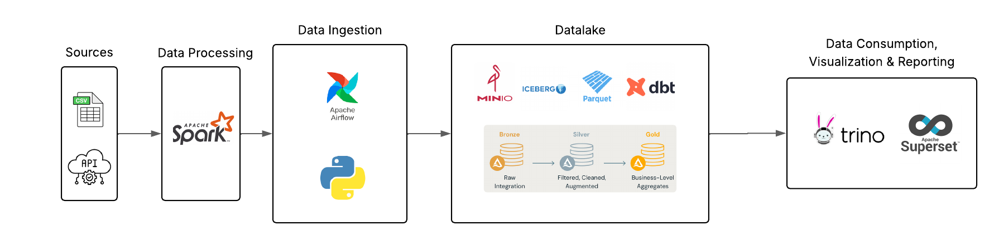

# Open-Source Data Lake

## Overview
A **100% open-source data lake** stack, containerized with Docker for portability, based on **AWS** infraestructure and implementing the **Medallion Architecture** (Bronze, Silver, Gold layers).

## Medallion Architecture  

Bronze: Raw data in MinIO (S3-compatible)

Silver: Validated, partitioned datasets

Gold: Business aggregates

## Core Technologies

### **1. Storage & Metadata**
- **MinIO**: S3-compatible object storage 
- **Hive Metastore**: Metadata storage in MariaDB

### **2. Processing**
- **Apache Spark**: standalone cluster
- **dbt**: SQL transformations 

### **3. Orchestration**
- **Airflow**: Jobs scheduling

### **4. Data Consumption**
- **Trino**: Distributed SQL engine
- **Superset**: Visualizations & Dashboards

---

## Key Features
- **Pure Open-Source**
- **Dockerized**
- **AWS-Compatible**: Based on the AWS ecosystem.

---
# Installation (before run the containers)

## Airflow

Create the directories first: 
```
mkdir -p ./orchestration/airflow/{dags,logs,plugins,config} ./data/minio
echo "AIRFLOW_UID=$(id -u)" > .env
```
## MinIO

Add the MinIO root credentials (console and S3 API) to `.env`:
```
echo "MINIO_ROOT_USER=<user>" >> .env
echo "MINIO_ROOT_PASSWORD=<password>" >> .env
```
Create a MinIO access key for Trino and the Hive Metastore and add it to `.env`:
```
echo "MINIO_ACCESS_KEY=<access-key>" >> .env
echo "MINIO_SECRET_KEY=<secret-key>" >> .env
```
## Service credentials

Database and admin users for local development. Database passwords end up in connection URLs, so avoid `@`, `:`, `/` and `%`.
```
cat >> .env <<EOF
AIRFLOW_DB_USER=<user>
AIRFLOW_DB_PASSWORD=<password>
_AIRFLOW_WWW_USER_USERNAME=<user>
_AIRFLOW_WWW_USER_PASSWORD=<password>
SUPERSET_DB_USER=<user>
SUPERSET_DB_PASSWORD=<password>
SUPERSET_ADMIN_USERNAME=<user>
SUPERSET_ADMIN_PASSWORD=<password>
MARIADB_ROOT_PASSWORD=<password>
METASTORE_DB_USER=<user>
METASTORE_DB_PASSWORD=<password>
EOF
```
## Secret keys

```
echo "AIRFLOW_SECRET_KEY=$(openssl rand -base64 16)" >> .env
echo "SUPERSET_SECRET_KEY=$(openssl rand -base64 42)" >> .env
```
## Virtual Environment (in WSL)

### Install
```
apt install python3.10-venv
```
### Creation
Create the virtual env at ./elt/dbt:
```
python3 -m venv dbt-env
```
### Activation

```source dbt-env/bin/activate```

### Deactivation
```deactivate```

## Install DBT trino and postgres
```python3 -m pip install dbt-core dbt-trino dbt-postgres```

# Docker & Images versions

* **Docker**: 4.4.0
* **Airflow**: apache/airflow:2.9.0-python3.12
* **Postgres**: postgres:13
* **Spark**: bitnamilegacy/spark:3.5
* **Redis**: redis:7.4
* **Trino**: trinodb/trino:424
* **MariaDB**: mariadb:10.5.8
* **Hive-Metastore**: bitsondatadev/hive-metastore:latest
* **MinIO**: pgsty/minio:RELEASE.2026-08-04T00-00-00Z
* **Superset**: apache/superset:4.1.2

# Create containers

```
docker compose up --build -d
```
# Repository layout

```
docker/                     # Dockerfiles (build context) and container init scripts
infra/
├── trino/etc/              # Trino config + catalogs (minio, iceberg, ...)
└── hive-metastore/         # metastore-site.xml
orchestration/airflow/
├── config/                 # config.cfg (AIRFLOW_CONFIG)
├── dags/
│   ├── <domain>/           # One DAG per dataset, e.g. snbe/snbe_pipeline.py
│   └── _examples/          # Stack smoke tests (Spark, Trino)
├── logs/                   # (ignored)
└── plugins/
elt/
├── ingestion/              # Bronze: extract + load into MinIO
│   ├── requirements.txt    # DuckDB-based loaders (run from the host)
│   └── banking/            # Itahu Postgres -> s3://bronze/banking/
├── ddl/                    # Trino DDL for schemas and Bronze external tables
│   ├── create_schemas.sql
│   └── bronze/{banking,ips,tsje}/
├── metadata/               # Schema/metadata exporters (minio.metadata.datalake_schemas)
├── dbt/                    # Silver + Gold (single dbt project)
│   └── models/
│       ├── silver/<domain>/
│       └── gold/<domain>/
└── spark/examples/         # Spark smoke test (used by _examples/test_spark_dag.py)
data/minio/                 # MinIO data (ignored)
viz/                        # Superset home
```

`./elt` is mounted at `/opt/airflow/elt` (Airflow) and `/opt/bitnami/spark/elt` (Spark).

dbt schemas are taken verbatim from `+schema` (`macros/generate_schema_name.sql`): `silver/` models land in `iceberg.silver`, `gold/` in `iceberg.gold`. The Trino connection in `elt/dbt/profiles.yml` can be overridden with `DBT_TRINO_HOST`, `DBT_TRINO_PORT` and `DBT_TRINO_USER`.

## Migrating an existing clone

MinIO data and Airflow logs are not tracked, so move them by hand after pulling (with the stack down):
```
docker compose down
mkdir -p data orchestration/airflow
mv lake/data data/minio
mv airflow/logs orchestration/airflow/logs   # optional, keeps old task logs
rm -rf lake airflow                          # only empty leftovers remain
docker compose up --build -d
```
The three old SNBE DAGs (`insert_iceberg_silver_snbe`, `snbe_active_users_cumulated`, `snbe_travels_per_bus_daily`) are replaced by `snbe_pipeline`; their run history stays in the Airflow DB until deleted from the UI.

# Architecture 



